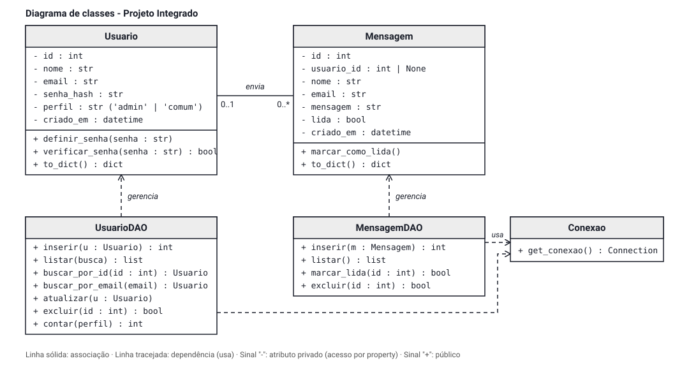

# Portfólio Bernardo — Projeto Integrado (DWS + POO + BD)

Site pessoal com back-end em Python (Flask, programação orientada a objetos com DAOs) e banco de dados MySQL.
O front-end (HTML, CSS e JavaScript) conversa com a API em JSON usando Fetch.
Projeto individual do Colégio UNASP-HT, Técnico em Informática (2º TI).

## Status das etapas

| Etapa | Prazo | Situação |
|---|---|---|
| 1 — Modelagem e banco de dados | 09/11/2026 | Concluída: UML, tabelas e conexão |
| 2 — Back-end (classes, DAOs e rotas Flask) | 13/11/2026 | Concluída: CRUD de usuários e mensagens, login |
| Final — Front-end com Fetch | 17/11/2026 | Concluída: páginas consumindo a API |

## Modelo de dados

Diagrama de classes: [docs/diagrama_classes.svg](docs/diagrama_classes.svg)



| Tabela | Campos |
|---|---|
| `usuarios` | id, nome, email (único), senha_hash, perfil (`admin` ou `comum`), criado_em |
| `mensagens` | id, usuario_id (opcional, chave estrangeira para `usuarios`), nome, email, mensagem, lida, criado_em |

Um usuário pode enviar várias mensagens (0..*), e uma mensagem pode ou não ter usuário (0..1).
Ao excluir um usuário, as mensagens dele ficam no banco com `usuario_id` nulo (`ON DELETE SET NULL`).

## Como o back-end está organizado

```
├── app.py                 cria o Flask, registra as rotas e serve o site
├── config.py              leitura do arquivo .env
├── criar_banco.py         cria o banco/tabelas (e atualiza tabela antiga da fase PHP)
├── testar_conexao.py      confere a conexão e lista as tabelas
├── schema.sql             estrutura do banco de dados
├── models/                classes do domínio com validação (Usuario, Mensagem)
├── dao/                   acesso ao banco: conexao.py, usuario_dao.py, mensagem_dao.py
├── rotas/                 rotas Flask por assunto (auth, usuarios, mensagens, times, sistema)
├── index.html, pages/     páginas do site
├── css/, js/, img/        estilos, scripts (Fetch) e imagens
└── docs/                  diagrama de classes (UML)
```

Camadas: **rota** (recebe e responde JSON) → **model** (valida os dados) → **DAO** (único lugar com SQL).
Todas as consultas usam parâmetros (`%s`), nunca concatenação de texto.

## Como rodar

Pré-requisitos: Python 3.10+ e MySQL (ou XAMPP) em execução.

```bash
# 1. Ambiente virtual e dependências
python -m venv venv
venv\Scripts\activate          # Windows
# source venv/bin/activate     # Linux/Mac
pip install -r requirements.txt

# 2. Configuração do banco
copy .env.example .env         # Windows (Linux/Mac: cp .env.example .env)
# edite o .env com o usuário e a senha do seu MySQL e troque a SECRET_KEY

# 3. Criar banco e tabelas (pode rodar de novo sem perder dados)
python criar_banco.py

# 4. Testar a conexão
python testar_conexao.py

# 5. Subir o servidor
python app.py
```

Abra **http://127.0.0.1:5000/** no navegador (não abra os arquivos .html com dois cliques: o site precisa ser aberto pelo Flask).

O **primeiro usuário cadastrado vira administrador**. Os próximos são usuários comuns; o administrador pode mudar o perfil deles.

## Páginas

| Página | Quem acessa | O que faz |
|---|---|---|
| `/` , `/pages/sobre.html` | todos | apresentação e busca de time de futebol |
| `/pages/contato.html` | todos | envia mensagem (salva no banco) |
| `/pages/cadastro.html` | todos | cria conta (Create) |
| `/pages/login.html` | todos | entra no sistema |
| `/pages/dashboard.html` | logado | boas-vindas, atalhos e resumo (admin) |
| `/pages/editar.html?id=` | logado | edita o próprio perfil; admin edita qualquer um (Update) |
| `/pages/usuarios.html` | admin | lista, busca e exclui usuários (Read e Delete) |
| `/pages/mensagens.html` | admin | lê, marca como lida e exclui mensagens |

## Rotas da API (JSON)

| Método e rota | Acesso | O que faz |
|---|---|---|
| `POST /api/usuarios` | público | cadastra usuário |
| `GET /api/usuarios?busca=` | admin | lista usuários (busca por nome ou e-mail) |
| `GET /api/usuarios/<id>` | o próprio ou admin | mostra um usuário |
| `PUT /api/usuarios/<id>` | o próprio ou admin | atualiza (só admin muda o perfil, nunca o próprio) |
| `DELETE /api/usuarios/<id>` | admin | exclui (não pode excluir a si mesmo) |
| `POST /api/login` | público | inicia a sessão |
| `POST /api/logout` | público | encerra a sessão |
| `GET /api/me` | logado | dados de quem está logado |
| `POST /api/mensagens` | público | envia mensagem de contato |
| `GET /api/mensagens` | admin | lista mensagens |
| `PATCH /api/mensagens/<id>/lida` | admin | marca como lida |
| `DELETE /api/mensagens/<id>` | admin | exclui mensagem |
| `GET /api/times?nome=` | público | busca time na TheSportsDB (o Flask faz a consulta) |
| `GET /api/saude` | público | confere a conexão com o banco |

Códigos usados: 200 e 201 (sucesso), 400 (dados inválidos), 401 (não logado), 403 (sem permissão),
404 (não encontrado), 409 (e-mail já cadastrado), 502 (serviço externo fora do ar).

## Segurança

- Senhas guardadas só como hash (Werkzeug); a resposta da API nunca devolve a senha.
- Consultas SQL parametrizadas; textos exibidos no site com `textContent` (sem injeção de HTML).
- Sessão por cookie assinado (`HttpOnly`, `SameSite=Lax`); rotas que alteram dados só aceitam JSON.
- Permissões conferidas no servidor (a tela escondida não protege nada sozinha).
- O arquivo `.env` (senha do banco) não vai para o GitHub.

## Tecnologias

Python, Flask, MySQL, mysql-connector-python, HTML, CSS e JavaScript (Fetch).
